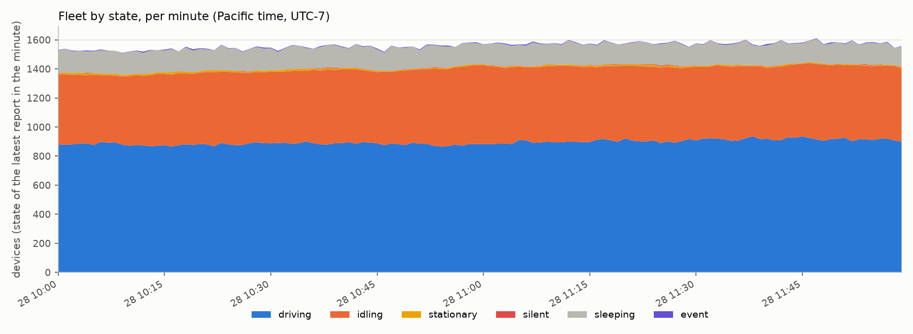
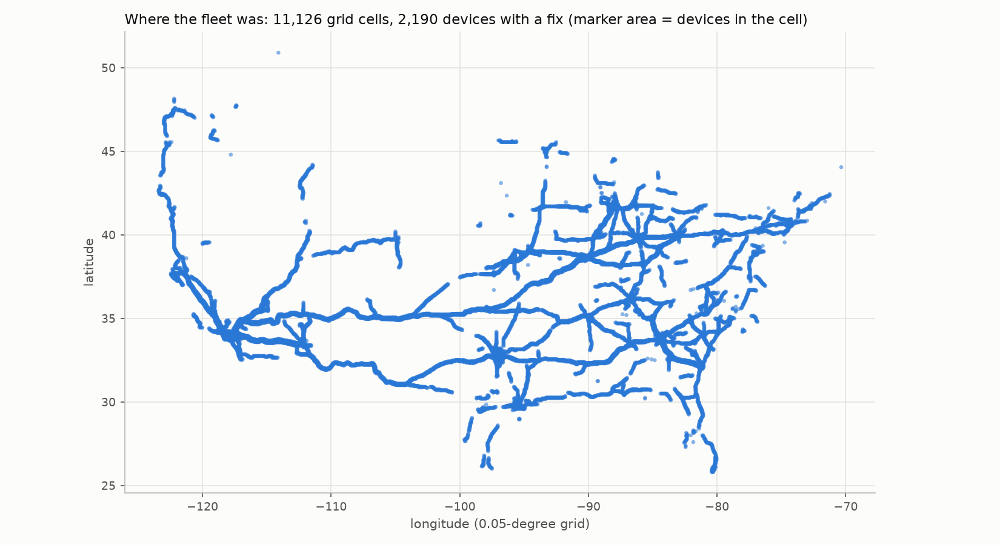
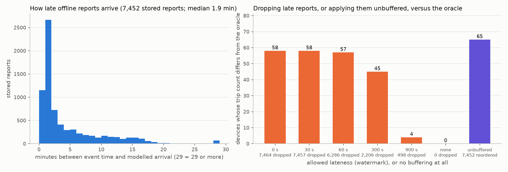

# eld-telemetry-replay

**Replay two hours of a fleet's raw ELD telemetry as a stream, and find out what a real-time consumer gets right, gets wrong, and never sees.**

[](https://github.com/JacobCCMorgan/eld-telemetry-replay/actions/workflows/ci.yml)

An electronic logging device publishes a telemetry record every 30 seconds while the truck moves and every
five minutes while it sleeps: GPS position and speed, wheel speed, RPM, engine hours and miles from the ECM,
battery and firmware state. The platform behind a fleet of two thousand such devices consumes that stream in
real time to keep each vehicle's state, cut it into trips and stops, raise ECM-disconnect alerts and feed
hours-of-service totals. Most of the analytics projects built on this data ([foundation](https://github.com/JacobCCMorgan/telematics-data-foundation),
[ECM disconnect](https://github.com/JacobCCMorgan/eld-ecm-disconnect), [firmware log parser](https://github.com/JacobCCMorgan/eld-device-log-parser),
[logbook toolkit](https://github.com/JacobCCMorgan/fmcsa-eld-logbook-toolkit)) worked from batch exports. This one takes the
raw reports themselves, 354,874 of them from 2,191 devices on one afternoon, replays them in order through
stateful per-device consumers, and measures what those consumers see, including what happens when offline
reports arrive late.

[Report](reports/replay_report.md) · [Input provenance](data/input/SOURCE.md)

## Findings

Numbers are from `reports/replay_report.md`, regenerated by one command from the published stream.

- **The fleet at a glance.** In a typical minute 1,567 devices report: 893 moving, 503 with the engine running
  but not moving, 148 asleep. Driving reports keep their 30-second cadence (98.2 % of intervals are 35 s or
  shorter); only 41 gaps over 90 s occurred while driving, on 19 devices.
- **ECM silence while moving is rare fleet-wide and concentrated in device batches.** 4,291 reports (1.2 %) on
  58 devices (2.6 %) carried GPS motion with no RPM. The share of moving reports affected is 29 % in the
  provider's test group, 12 % in the Volvo 2026 batch and 12 % on OBD-II units, against 0.9 % in the largest
  customer batch.
- **The ECM-disconnect project's ranking holds on an independent data path.** Its tiers came from the platform's
  anomaly export. Measured on the raw stream, tier P1 devices are ECM-silent in 84 % of their driving reports,
  P2 in 20 %, P3 in 0 % and P4 in 2.4 %. Two pipelines that never touch each other agree on who the worst
  devices are.
- **The corrected ERR005 rule changes almost nothing at fleet level.** The shipped rule (any ECM field missing)
  sends 85 events from 62 devices in two hours; the speed-and-RPM rule proposed after the firmware log analysis
  sends 84 from 61. The OBD-II false positive seen on one test vehicle is not the fleet's pattern.
- **Odometer anomalies are a protocol problem.** 114 regressions and 136 impossible jumps between valid
  readings; 227 of the 250 are on the 7 J1708 units. A further 556 driving or idling reports carry an odometer
  of 0, which the device writes when the ECM does not answer: a consumer that treats 0 as a reading sees
  1,100 false regressions and 1,139 false jumps instead.
- **One device drove for two hours without moving.** GPS and wheel speed disagree by more than 15 km/h in 979
  reports on 410 devices; 239 of them are a single device whose ECM frame is frozen (125 km/h, 4,016 RPM in
  every report while a valid GPS fix shows it standing still). Every one of those reports counts as driving in
  mileage and hours-of-service totals. A check that compares the two speed sources catches it on the second
  report.
- **Half of the moving fleet has no driver logged in.** 101,901 moving reports (49 %) from 1,080 devices carry
  no driver id; 689 devices raised an unidentified-driving event within the two hours.
- **Trips and stops.** 2,789 trips on 1,598 devices (1,137 complete inside the window, median 5.3 min),
  3,173 stops of five minutes or more (median 22.6 min). The segmenter reproduces the 1,013 Driving-to-Sleeping
  transitions the devices themselves reported.
- **Late data is small, and ordering matters more than lateness.** 7,464 reports (2.1 %) came out of the
  devices' offline buffers, on 1,154 devices in 3,527 episodes; under the reconnection model they arrive a
  median 1.9 min late, 70 % within five minutes, the slowest after 47 min. Dropping everything late changes the
  trip count of 58 devices; a five-minute watermark leaves 45 wrong, a fifteen-minute one 4. A consumer that
  keeps every report but applies them unbuffered in arrival order is worse than dropping them: 65 devices wrong
  and 84 trips cut by phantom gaps, against 9 in the oracle.







## What to do with it

- **Buffer by event time, with a watermark of about fifteen minutes.** The lateness distribution says where to
  put it: 93 % of stored reports arrive within fifteen minutes, and at that watermark the trip output is within
  four devices of the oracle. Applying reports in arrival order without buffering is the one option that is
  worse than dropping them.
- **Treat an odometer of 0 as missing, not as a reading**, and expect J1708 units to need their own tolerance.
- **Compare GPS speed with wheel speed on every report.** A frozen ECM frame is invisible to a consumer that
  trusts the ECM; it is a one-line check against the GPS.
- **Keep the shipped ERR005 rule.** The correction matters on OBD-II vehicles and nowhere else in this fleet;
  the one-hour cooldown is what keeps the event count sane, not the field list.
- **The ECM-disconnect tiers can be refreshed from the stream** instead of waiting for the anomaly export; the
  check in `eldreplay report` is the refresh.

## Method

- **Replay.** Reports are ordered by (arrival time, event time, device, row) and pushed through pluggable sinks
  (`eldreplay.replay`), paced or as fast as the consumer accepts. Each consumer keeps one small tracker per
  device: last timestamp, last valid odometer, last derived state, cooldown deadlines, last speed and RPM.
- **Derived state.** Driving when GPS or wheel speed is at least 8 km/h (the firmware's own trigger), idling when
  the engine reports but the vehicle does not move, silent when neither speed nor RPM is reported, sleeping and
  event records as the device reports them (`eldreplay.consumer`).
- **Checks.** ECM silence (GPS motion, no RPM, the ECM-disconnect definition); ERR005 under the shipped rule and
  the corrected rule, both with the firmware's one-hour per-device cooldown; speed mismatch and frozen ECM
  frame; odometer regression and jump between valid readings (zeros skipped and counted separately); report gaps
  while driving; GPS invalid while moving; Sleeping while moving.
- **Trips and stops.** A trip starts at the first moving report and ends at a five-minute stationary span, a
  Sleeping report or a ten-minute silence; stops are stationary spans of five minutes or more between trips;
  distance is the odometer difference, because positions are on a 0.05-degree grid (`eldreplay.trips`).
- **Late data.** The export carries event time only. A report flagged as stored was written to the device's
  offline buffer; its arrival is modelled as the device's next live report plus 20 s, the replay delay the
  firmware log parser project measured (10 to 32 s after reconnection). Strategies: drop reports later than a
  watermark (0, 30, 60, 300, 900 s, none), or apply them unbuffered in arrival order; each is compared with the
  oracle (every report, event-time order) on per-device trip counts and hours (`eldreplay.latedata`).
- **Cross-checks.** The ECM-disconnect priority list (182 devices, commit `21def15`) is joined to the stream by
  device key and its tiers measured on driving reports; the 1,013 Driving-to-Sleeping transitions in the
  devices' own mode field are compared with the segmenter's sleep-ended trips.

## Repository layout

```
data/input/              telemetry_2026-09-28.parquet (354,874 reports), ecm_priority_list_21def15.csv, SOURCE.md
scripts/prepare_inputs.py  builds the published stream from the raw export (needs the raw file and the key; not in the repo)
src/eldreplay/replay.py    Report, sinks, ordering, the paced replayer
src/eldreplay/consumer.py  per-device tracker: derived state, ECM rules, consistency checks
src/eldreplay/trips.py     trip and stop segmentation as a streaming consumer
src/eldreplay/latedata.py  arrival model, lateness statistics, watermark and arrival-order strategies
src/eldreplay/metrics.py   fleet timeline, check and batch summaries, cadence, unidentified driving, tier check
src/eldreplay/report.py    figures and the Markdown report
src/eldreplay/cli.py       eldreplay replay | consume | trips | latedata | report
reports/                 generated: replay_report.md, figures/, tables/ (CSV, Parquet, summary.json)
tests/                   31 tests: input pins, ordering and pacing, every check, segmentation, arrival model, strategies, report, CLI
```

## Reproduce

```bash
git clone https://github.com/JacobCCMorgan/eld-telemetry-replay.git
cd eld-telemetry-replay
python -m venv .venv && source .venv/bin/activate
pip install -e ".[dev]"
pytest -q                                   # about 15 seconds
eldreplay report                            # the full report into reports/, about two minutes
eldreplay --devices 200 consume             # the check summary on the first 200 devices, a few seconds
eldreplay --devices 50 replay --speed 600 --out /tmp/stream.jsonl   # paced replay: ten minutes of telemetry per second
eldreplay latedata                          # the arrival model and the strategy table
```

CI runs the tests and the full report on every push and fails if the committed report differs from a fresh run.

## Data

`data/input/telemetry_2026-09-28.parquet` is a de-identified two-hour export of the raw ELD reports of a
working fleet: 354,874 reports from 2,191 devices, 16:59:57 to 18:59:57 UTC on 28 September 2026. Device,
vehicle and driver identifiers are keyed HMAC pseudonyms shared with the other projects (so the stream joins
their tables), coordinates are rounded to a 0.05-degree grid, organisation names are reduced to the device batch
label, and no free text, contact, IMEI, ICCID or sequence-number fields are present. The priority list is copied
from the ECM-disconnect project. Everything is documented in [`data/input/SOURCE.md`](data/input/SOURCE.md).

## Limitations

- **Two hours of one afternoon.** Trip and stop durations are truncated by the window (1,652 of 2,789 trips touch
  an edge); the shares and rates are for that slice, not the fleet's day. Fleet-wide patterns (cadence, ECM
  silence by batch, driver login) are stable enough at this size to act on; the one frozen device is one device.
- **Arrival is modelled, not observed.** The export has no server receive time. The model (next live report plus
  20 s) follows what the firmware log showed for one device; the strategy comparison is only as good as that.
- **Positions are coarse.** Distances come from the odometer; a GPS-based plausibility check would need the raw
  coordinates, which are not published.
- **The devices' own "Driving" mode is not the consumer's "driving" state.** The device enters Driving on its
  own trigger and stays there while idling; the consumer derives state per report, which is why 503 devices can
  be "idling" inside what the device calls Driving.

## License

MIT.
