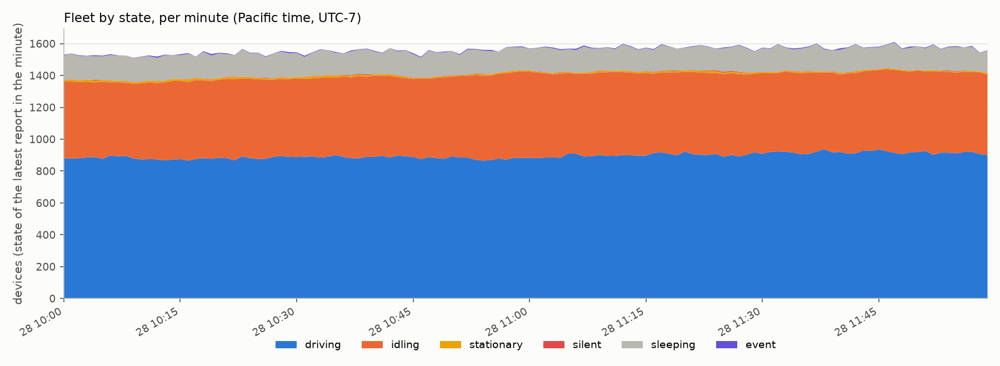
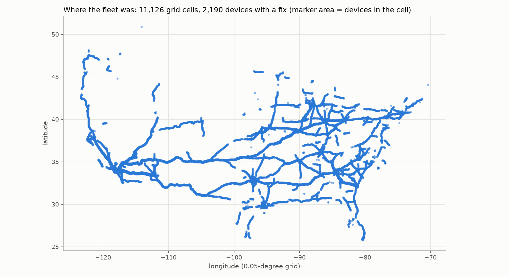
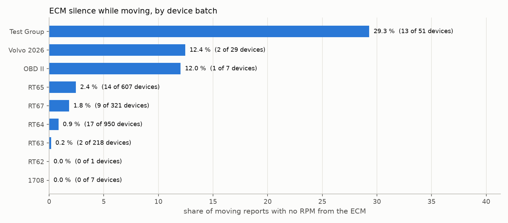
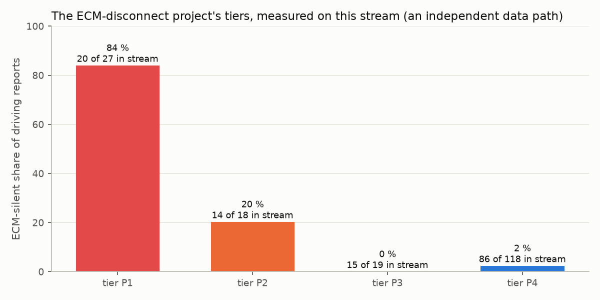
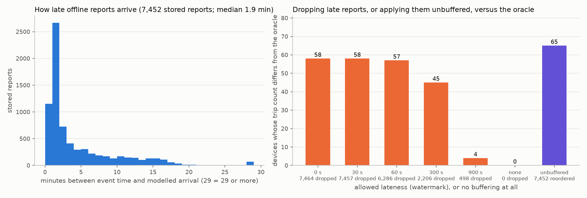
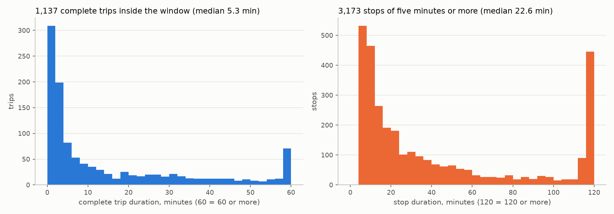

# Replaying two hours of fleet telemetry: what a streaming consumer sees

Stream: 354,874 reports from 2,191 devices, 2026-09-28T16:59:57+00:00 to 2026-09-28T18:59:57+00:00 (UTC), replayed in event-time order through the per-device consumer, the trip segmenter and the late-data strategies. Figures and tables are regenerated by `eldreplay report`.

## Findings

1. **The fleet at a glance.** In a typical minute 1,567 devices report: about 893 moving, 503 with the engine running but not moving, 148 asleep. Driving reports keep the 30-second cadence: 98.2 % of intervals are 35 s or shorter and only 41 gaps over 90 s occurred, on 19 devices.
2. **ECM silence while moving is rare fleet-wide and concentrated in batches.** 4,291 reports (1.21 %) on 58 devices (2.6 %) carried GPS motion with no RPM. The share of moving reports affected is 29 % in the provider's test group, 12 % in the Volvo 2026 batch and 12 % on OBD-II units, against 0.9 % in the largest customer batch (RT64).
3. **The ECM-disconnect project's ranking holds on an independent data path.** Its tiers were built from the platform's anomaly export; measured on the raw device stream, tier P1 devices are ECM-silent in 84 % of their driving reports, P2 in 20 %, P3 in 0 % and P4 in 2.4 % (20 of 27 P1 devices reported in the window).
4. **The corrected ERR005 rule changes almost nothing at fleet level.** With the firmware's one-hour cooldown, the shipped rule (any ECM field missing) sends 85 events from 62 devices in two hours; the speed-and-RPM rule sends 84 from 61. The OBD-II false positive found on one test vehicle in the firmware log parser project (engine hours never available) is not the fleet's pattern: here engine hours are missing almost only when speed and RPM are missing too.
5. **Odometer anomalies are a protocol problem.** 114 regressions and 136 impossible jumps between valid readings, 227 of them on the 7 J1708 units; the J1939 batches contribute single digits. Separately, 556 driving or idling reports carry an odometer of 0 (the device writes 0 when the ECM does not answer), 228 of them in the test group and 159 in batch RT67.
6. **One device drove for two hours without moving.** GPS and wheel speed disagree by more than 15 km/h in 979 reports on 410 devices; 239 of them are one device (batch RT62) whose ECM frame is frozen: the same speed and RPM in every report of the window while a valid GPS fix shows it standing still. The `ecm_frozen` check raises 238 reports on 1 device in total; every one of those reports counts as driving in the platform's mileage and hours-of-service totals. The other mismatches are mostly single reports around acceleration and braking, where the two sources lag each other.
7. **Half of the moving fleet has no driver logged in.** 101,901 moving reports (49 %) from 1,080 devices carry no driver id, and 689 devices raised an unidentified-driving event within the two hours (900 start, 863 diagnostic, 885 cleared). The logbook toolkit project saw the same thing on one driver's file; this is the fleet-wide rate.
8. **Trips and stops.** 2,789 trips on 1,598 devices, 1,137 of them complete inside the window (median 5.3 min, 0.4 miles: short moves dominate a two-hour slice), 3,173 stops of five minutes or more (median 22.6 min). The segmenter reproduces the 1,013 Driving-to-Sleeping transitions the devices themselves reported.
9. **Late data is small but not negligible, and ordering matters more than lateness.** 7,464 reports (2.1 %) were written to the offline buffer, on 1,154 devices in 3,527 episodes; under the reconnection model they arrive a median 1.9 min late, 70 % within five minutes, the slowest after 47 min (12 arrive after the window). A consumer that drops everything late (watermark 0) loses 7,464 reports and changes the trip count of 58 devices; a five-minute watermark leaves 45 devices different. A consumer that applies reports in arrival order without buffering keeps every report but sees 7,452 of them out of order and still gets 65 devices wrong (84 trips cut by phantom gaps, against 9 in the oracle).













## 1. Consumer checks

| check | reports | share_of_reports | devices | share_of_devices |
|---|---|---|---|---|
| ecm_silent | 4,291 | 0.0121 | 58 | 0.0265 |
| ecm_silent_rpm_or_speed | 4,612 | 0.0130 | 61 | 0.0278 |
| err005_shipped | 4,613 | 0.0130 | 62 | 0.0283 |
| err005_shipped_sent | 85 | 0.0002 | 62 | 0.0283 |
| err005_corrected | 4,612 | 0.0130 | 61 | 0.0278 |
| err005_corrected_sent | 84 | 0.0002 | 61 | 0.0278 |
| speed_mismatch | 979 | 0.0028 | 410 | 0.1871 |
| ecm_frozen | 238 | 0.0007 | 1 | 0.0005 |
| odometer_regress | 114 | 0.0003 | 3 | 0.0014 |
| odometer_jump | 136 | 0.0004 | 12 | 0.0055 |
| odometer_zero | 556 | 0.0016 | 5 | 0.0023 |
| gap_while_driving | 41 | 0.0001 | 19 | 0.0087 |
| gps_invalid_moving | 104 | 0.0003 | 34 | 0.0155 |
| sleeping_while_moving | 0 | 0.0000 | 0 | 0.0000 |

## 2. By device batch

| org_group | devices | reports | driving_reports | ecm_silent | devices_ecm_silent | ecm_silent_share_of_driving | err005_shipped_events | err005_corrected_events | odometer_regress | odometer_jump | odometer_zero | speed_mismatch | ecm_frozen | stored_share |
|---|---|---|---|---|---|---|---|---|---|---|---|---|---|---|
| RT64 | 950 | 152,590 | 93,639 | 794 | 17 | 0.0085 | 23 | 23 | 1 | 2 | 0 | 260 | 0 | 0.0211 |
| RT65 | 607 | 98,147 | 57,951 | 1,416 | 14 | 0.0244 | 20 | 20 | 0 | 5 | 0 | 291 | 0 | 0.0193 |
| RT67 | 321 | 51,871 | 28,738 | 523 | 9 | 0.0182 | 15 | 14 | 0 | 1 | 159 | 81 | 0 | 0.0212 |
| RT63 | 218 | 38,674 | 22,483 | 38 | 2 | 0.0017 | 2 | 2 | 0 | 3 | 7 | 64 | 0 | 0.0253 |
| Test Group | 51 | 6,306 | 3,846 | 1,127 | 13 | 0.2930 | 21 | 21 | 0 | 11 | 228 | 35 | 0 | 0.0216 |
| Volvo 2026 | 29 | 4,844 | 2,618 | 326 | 2 | 0.1245 | 3 | 3 | 0 | 0 | 95 | 8 | 0 | 0.0182 |
| 1708 | 7 | 1,440 | 796 | 0 | 0 | 0.0000 | 0 | 0 | 113 | 114 | 0 | 1 | 0 | 0.0167 |
| OBD II | 7 | 763 | 557 | 67 | 1 | 0.1203 | 1 | 1 | 0 | 0 | 67 | 0 | 0 | 0.0288 |
| RT62 | 1 | 239 | 239 | 0 | 0 | 0.0000 | 0 | 0 | 0 | 0 | 0 | 239 | 238 | 0.0000 |

## 3. The ECM-disconnect tiers on this stream

| tier | devices | in_stream | reports | driving_reports | ecm_silent | devices_silent | ecm_silent_share_of_driving |
|---|---|---|---|---|---|---|---|
| P1 | 27 | 20 | 1,935 | 1,311 | 1,101 | 11 | 0.840 |
| P2 | 18 | 14 | 1,823 | 1,175 | 238.000 | 3 | 0.203 |
| P3 | 19 | 15 | 2,308 | 1,262 | 0.000 | 0 | 0.000 |
| P4 | 118 | 86 | 14,410 | 9,291 | 221.000 | 4 | 0.024 |

## 4. Cadence, unidentified driving, trips

```
{
  "cadence": {
    "intervals": 352683,
    "median_s": 30.0,
    "p90_s": 32.0,
    "p99_s": 298.0,
    "share_within_35s": 0.9374,
    "driving_intervals": 329397,
    "driving_share_within_35s": 0.9821,
    "gaps_over_90s_while_driving": 41,
    "devices_with_gap_while_driving": 19
  },
  "unidentified": {
    "event_records": 2648,
    "by_type": {
      "unidentified_driving": 900,
      "unidentified_driving_diagnose": 863,
      "unidentified_driving_clear_speed": 718,
      "unidentified_driving_clear_driver": 167
    },
    "devices_with_unidentified_driving_event": 689,
    "moving_reports_without_driver": 101901,
    "devices_moving_without_driver": 1080,
    "share_of_moving_reports_without_driver": 0.4866
  },
  "trips": {
    "trips": 2789,
    "devices_with_trips": 1598,
    "complete_trips": 1137,
    "truncated_start": 896,
    "truncated_end": 1067,
    "end_reasons": {
      "stop": 1208,
      "window": 1067,
      "sleep": 505,
      "gap": 9
    },
    "trip_hours": 1915.3,
    "complete_trip_minutes_median": 5.3,
    "complete_trip_miles_median": 0.4,
    "stops": 3173,
    "stop_minutes_median": 22.6,
    "driving_to_sleeping_transitions": 1013
  }
}
```

## 5. Late data

```
{
  "reports": 354874,
  "stored_reports": 7464,
  "stored_share": 0.021,
  "devices_with_stored": 1154,
  "devices": 2191,
  "offline_episodes": 3527,
  "arrive_after_window": 12,
  "lateness_s_median": 112.0,
  "lateness_s_p90": 776.0,
  "lateness_s_max": 2841.0,
  "share_within_60s": 0.1581,
  "share_within_300s": 0.7049,
  "share_within_900s": 0.934
}
```

| strategy | allowed_lateness_s | records_kept | records_dropped | out_of_order | trips | trip_hours | trips_ended_by_gap | devices_with_different_trip_count | trip_count_abs_diff | trip_hours_abs_diff |
|---|---|---|---|---|---|---|---|---|---|---|
| oracle |  | 354,874 | 0 | 0 | 2,789 | 1915 | 9 | 0 | 0 | 0 |
| drop_late | 0 | 347,410 | 7,464 | 0 | 2,836 | 1893 | 82 | 58 | 67 | 23 |
| drop_late | 30 | 347,417 | 7,457 | 0 | 2,836 | 1893 | 82 | 58 | 67 | 23 |
| drop_late | 60 | 348,588 | 6,286 | 0 | 2,837 | 1894 | 82 | 57 | 66 | 23 |
| drop_late | 300 | 352,668 | 2,206 | 0 | 2,834 | 1900 | 72 | 45 | 51 | 15 |
| drop_late | 900 | 354,376 | 498 | 0 | 2,790 | 1914 | 13 | 4 | 5 | 2 |
| drop_late |  | 354,874 | 0 | 0 | 2,789 | 1915 | 9 | 0 | 0 | 0 |
| arrival_order |  | 354,874 | 0 | 7,452 | 2,864 | 1895 | 84 | 65 | 77 | 21 |

## Method notes

* Replay: reports ordered by (arrival, event time, device, row); arrival = event time for live reports, the device's next live report plus a 20 s replay delay for stored ones
  (a model, see `eldreplay.latedata`).
* Derived state: driving when GPS or wheel speed is at least 8 km/h (the firmware's trigger), idling when the engine reports but the vehicle does not move, silent when
  neither speed nor RPM is reported, sleeping and event records as reported by the device.
* ECM silence: GPS speed above 0 with no RPM, the definition of the ECM-disconnect project. ERR005 shipped rule: GPS speed above 0 and any of speed, RPM, engine hours,
  engine miles missing; corrected rule: speed or RPM missing; both with the firmware's one-hour per-device cooldown.
* Odometer: zero readings are skipped; a regression is a decrease between valid readings, a jump an increase faster than 300 km/h.
* Frozen ECM frame: wheel speed at or above 8 km/h, a valid GPS fix below 1 km/h, and speed and RPM identical to the previous report.
* Trips: start at the first moving report, end at a five-minute stationary span, a Sleeping report or a ten-minute silence; stops are stationary spans of five minutes
  or more between trips.
* Coordinates are on a 0.05-degree grid, so distances come from the odometer, not from positions.
